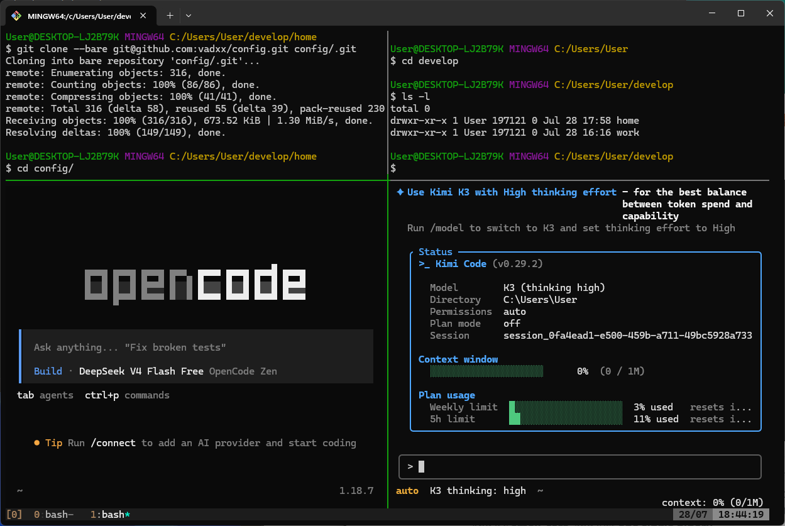

# config
My workstation configuration tips.  

#### Overview
- [Windows](./WINDOWS.md)
- [CLI Linux VM](./LINUX_VM.md)
- [LLM](./LLM.md)

#### References
- `Tmux`:
    - Config inspired from: https://github.com/geohot/configuration/blob/master/.tmux.conf
    - Hint: On `Windows` you can use this: https://github.com/psmux/psmux
- `Git`: Read my guide about setup: https://github.com/vadxx/git-tutorial
- `Flutter`: 
    - Read my guide about  setup: https://github.com/vadxx/flutter-tutorial
    - My app: https://github.com/vadxx/garage_app
- `Font`: The best one for my editors: https://github.com/microsoft/cascadia-code
- `Vless-client`: Very good one cross platform app: https://github.com/hiddify/hiddify-app